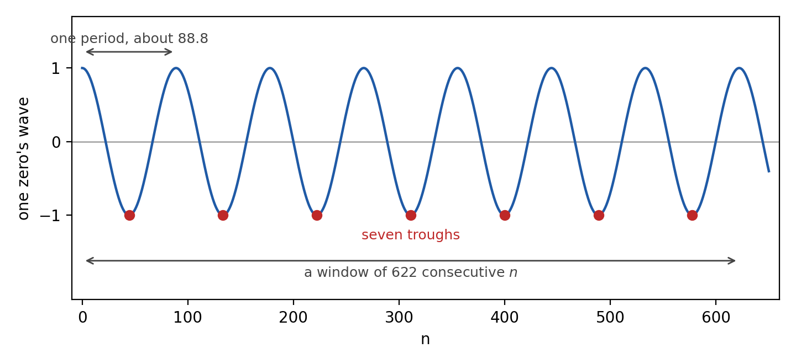
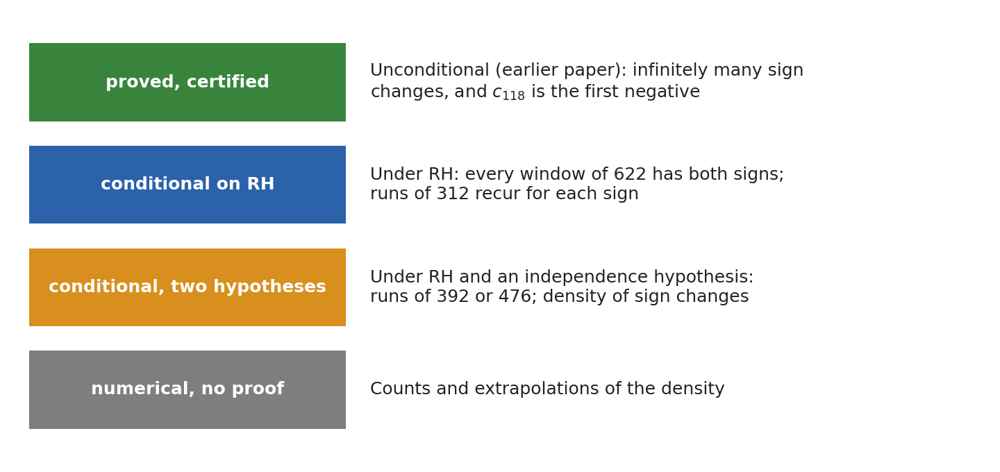

This is an introductory text to the research paper *Sign runs and the density of sign changes of Keiper-Li second differences* [[Per26]](https://doi.org/10.5281/zenodo.24486137), by the same author. The paper has the proofs and the full computations. This note has the idea. No equations are needed to follow it. It makes no claim the paper does not make, and for each claim it says whether it is proved, certified by computer with error bars, or only computed.

One caution comes first, and it matters more here than usual. **Every new result of the paper is conditional.** Most of them assume the Riemann hypothesis (RH), whose announced proof is described just below, and some assume a second, unproved, hypothesis about independence. The paper proves nothing unconditional about the questions below. It does not prove RH and it does not disprove it.

> **Status as of 27 November 2026:** on 20 November 2026 Levent Alpöge announced a proof of the Riemann hypothesis, found with Claude and released as a Lean 4 formalization of about 17 million lines, which the Lean FRO and the Mathlib Initiative certified on 21 November after checks by the Lean kernel and independent checkers; no complete human-readable proof has been published and no peer review by mathematicians has been reported, so the proof is machine-checked and human verification is still under way. If that proof is accepted, Theorems A and B hold without assuming RH. Theorems C, D and D$'$ would still need LI$_\theta(700)$ and LI$_\theta(1400)$, LI$_\theta$, and LI$_\theta(100)$ respectively, which the announced result does not supply. This note takes no side on the announced proof, and says neither that RH is open nor that it is proved.

# Where the earlier paper stopped

The Riemann zeta function has famous zeros, and RH says that they all lie on one straight line. A list of numbers $\lambda_1, \lambda_2, \lambda_3, \dots$, the **Li coefficients**, is computed from those zeros. Think of the list as the heights of points on a curve. The **second difference** $c_n$ measures how that curve bends at the point $n$: if $c_n$ is positive the curve bends upward there, like a bowl, and if it is negative it bends downward, like a hill.

The companion paper [[Per26a]](https://doi.org/10.5281/zenodo.24447746) and its introductory text settled the first question. It is **proved**, with no hypothesis, that $c_n$ is positive for infinitely many $n$ and negative for infinitely many $n$. It is **certified** by computer that $c_1, \dots, c_{117}$ are all positive and that $c_{118}$ is negative. So the curve bends upward for 117 steps, then flips, and it keeps flipping.

That leaves two questions that the earlier paper does not answer. How **long** can a stretch of one sign be? And how **often** does the sign change?

# The idea: one wave per zero

Under RH, each zero of zeta contributes one simple wave to $c_n$, a cosine that goes up and down as $n$ grows. Zeros higher up the line give faster waves and carry smaller weight. The sequence $c_n$ is the sum of all these waves. This is a formula of the paper (conditional on RH), not a guess.

The first zero has the heaviest weight and the slowest wave. One full period of its wave is about 88.8 steps long. Alone, it would be positive for about 44 steps, negative for the next 44, and so on. The question is how much the other zeros can disturb this.

{width=92%}

# A run cannot be longer than 621 (under RH)

A **run** is a maximal block of consecutive $n$ where $c_n$ has one sign. The first result, Theorem A, is **conditional on RH, and computer-assisted**: every window of 622 consecutive steps contains both a positive and a negative $c_n$, so every run is at most 621 long.

Here is the idea. Suppose a long run of positive values existed. Take the values of $c_n$ at the seven troughs of the first zero's wave inside that window, and add them up with fixed weights chosen so that all the weights are positive. The sum would then be positive. But at those points the first zero pushes the sum down by a fixed amount, and the paper shows by a certified computation, in ball arithmetic, that all the other zeros together cannot push it back up. They are bounded without any knowledge of their phases. This is a contradiction, so no such run exists. The same argument works for negative runs at the crests.

The computation covers 2000 zeros that were checked one by one with error bars, and a bound for everything beyond. The deduction of Theorem A from RH, Li's formula and the certified zeros is also checked in the proof assistant Lean 4. Earlier versions of the paper had a weaker bound, 1572, which the new one replaces.

# Runs of 312, again and again (under RH)

The second result, Theorem B, goes the other way. It is **conditional on RH, and computer-assisted**: runs of at least 312 consecutive positive values, and of 312 consecutive negative values, occur again and again, with positive lower density. The paper gives two explicit huge numbers, of about 1240 digits each, where such a run begins.

The idea is the reverse of the previous one. At a well chosen starting point, the first 300 zeros all have their waves lined up so that together they stay above the bound for all the other zeros for 312 steps. Then a compactness argument shows that this alignment recurs, in every block of bounded length. No independence hypothesis is used. Together, under RH the longest runs lie between 312 and 621. The paper says plainly that the true maximal length is **not known**.

{width=92%}

# Longer runs, with a second hypothesis

To go beyond 312 the paper adds a hypothesis, called $\mathrm{LI}_\theta$: a precise statement that the angles of the waves of the first zeros are independent of each other, in the sense that no whole-number combination of them gives zero. It is **unproved and open**. It is not the usual independence hypothesis on the zeros themselves, and the paper claims no relation between the two.

Under RH and this hypothesis for the first 700 zeros, Theorem C, **conditional and computer-assisted**, gives runs of 392 positive values, and of 392 negative values, with positive lower density. With the first 1400 zeros the length is 476. The density bound is astronomically small, about $10^{-2465}$ for the first case. The paper says that the point is only that it is positive. The reason is that independent angles make the waves wander over all combinations, and a certified computation shows that one combination, a phase chosen in advance, gives the run.

{width=92%}

# How often does the sign change?

The slowest wave alone changes sign about once every 44.4 steps, a share of about $0.0225$ of all steps. The paper compares the true sign changes with this. Under RH and the independence hypothesis in its strongest form, with every zero counted, Theorem D, **conditional and computer-assisted**, proves that the share of sign changes exists, and that it lies between $0.9695$ and $0.9710$ times the share of the first wave alone. So the sign changes of $c_n$ are slightly rarer than those of the first wave, by about 3 percent. They are not more frequent.

A variant, Theorem D$'$, gives a much narrower bracket for a model made of the first 100 waves only. It is **conditional**, and it is a statement about the model, not about $c_n$.

Three further items are **numerical** and not proofs. Models with more and more waves give ratios that settle near $0.970$, and a simple extrapolation gives about $0.9701$, with a band from $0.9698$ to $0.9704$. And in a public table of Li coefficients up to $n = 10^5$, the sign of $c_n$ changes 2173 times, which is a ratio of $0.9653$ to the first wave alone. The paper notes that a finite range need not match the limit, and that the table result is an illustration, not evidence for or against Theorem D.

{width=92%}

# What is established

{width=88%}

# What this note does not claim

It does not prove RH and it does not disprove it. The paper's results concern the sign of a sequence built from the Li coefficients, and they assume RH. Li's criterion is not used. The status of RH, with the paper's own list of conditional results, is in the note at the top.

It does not say that the independence hypothesis is true, and it does not claim to know the true longest run. It does not claim a complete survey of the literature. To the author's knowledge no earlier work bounds the runs of this sequence or computes the density of its sign changes. The methods, a torus model of a sum of waves, an equidistribution theorem of Weyl, and a Fourier computation, are classical in spirit, and the paper makes no claim of novelty for them. The program that checks the certificates has not been reviewed by a third party.

# Where to go next

- The paper itself [[Per26]](https://doi.org/10.5281/zenodo.24486137), with the proofs, the certificates, the Lean project and the scripts.
- The companion paper on the first sign change [[Per26a]](https://doi.org/10.5281/zenodo.24447746).
- The public code and certificates, at [github.com/mik-tf/keiper-li-sign-runs](https://github.com/mik-tf/keiper-li-sign-runs).

# References {-}

[Per26] M. Perreault, *Sign runs and the density of sign changes of Keiper-Li second differences*, 2026, Zenodo. [doi:10.5281/zenodo.24486137](https://doi.org/10.5281/zenodo.24486137).

[Per26a] M. Perreault, *Sign changes of Keiper-Li second differences*, 2026, Zenodo. [doi:10.5281/zenodo.24447746](https://doi.org/10.5281/zenodo.24447746).

```{=latex}
\par\ifdim\dimexpr\pagegoal-\pagetotal\relax<15\baselineskip\ifdim\pagetotal>0pt\newpage\fi\fi
```

# Read the research paper {-}

```{=latex}
\raggedright
```

The full paper, with the proofs, is *Sign runs and the density of sign changes of Keiper-Li second differences*, by Michaël Perreault.

DOI: [doi:10.5281/zenodo.24486137](https://doi.org/10.5281/zenodo.24486137)
